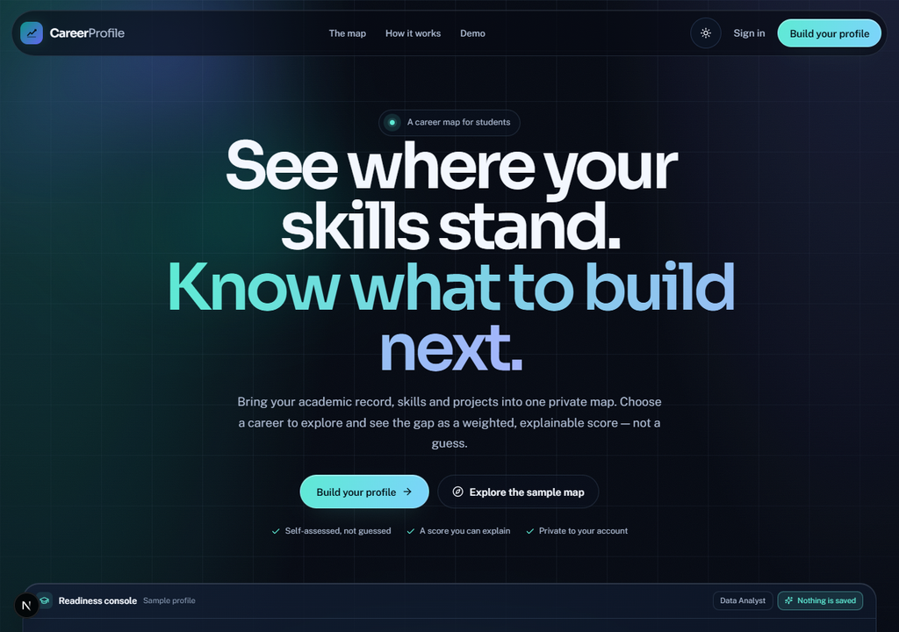
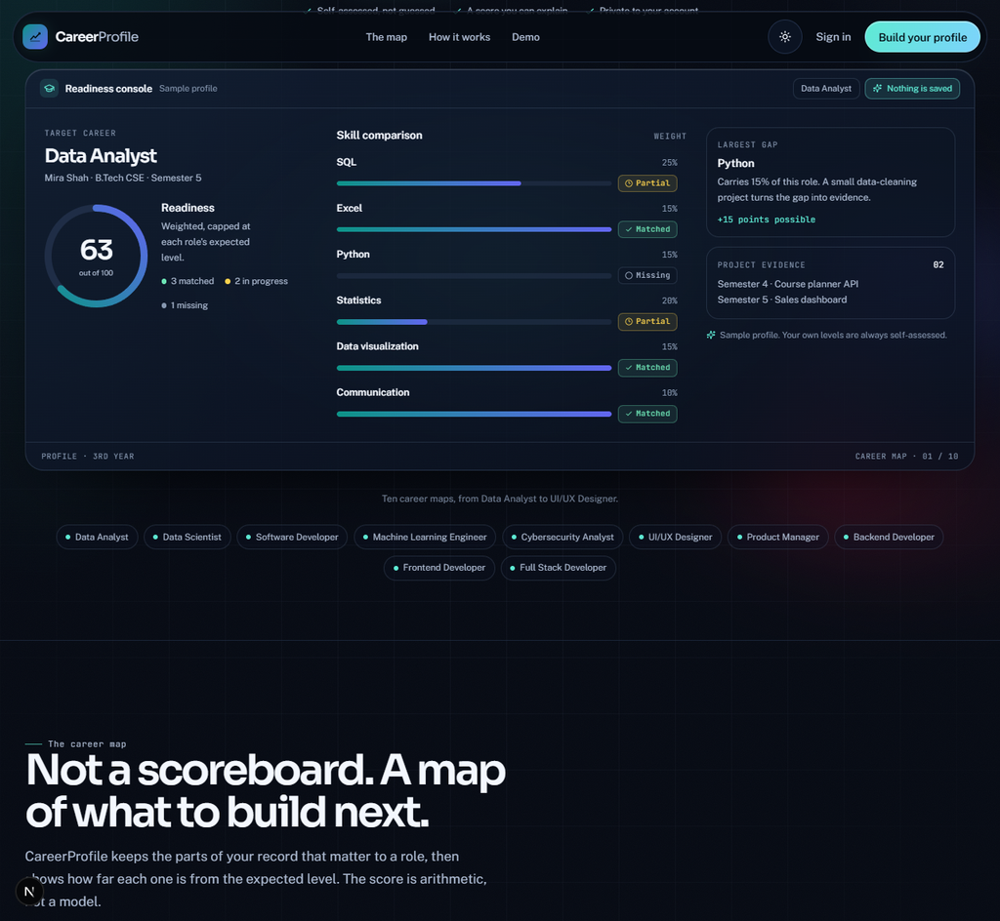
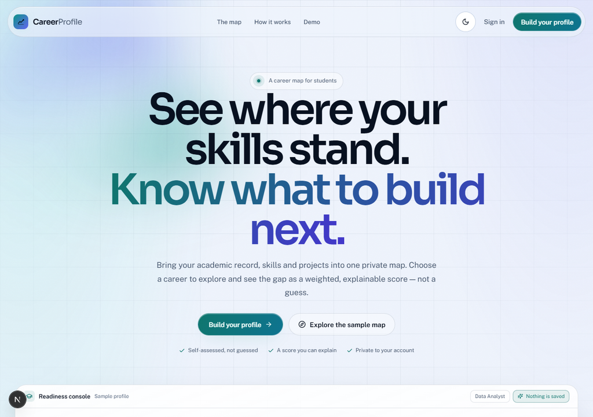
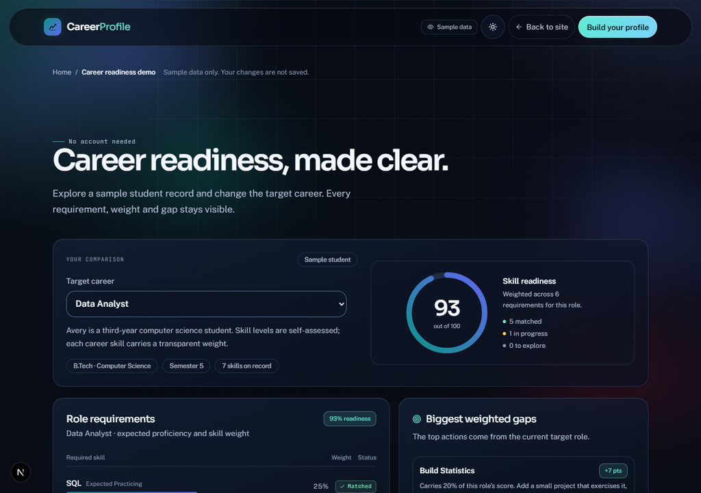
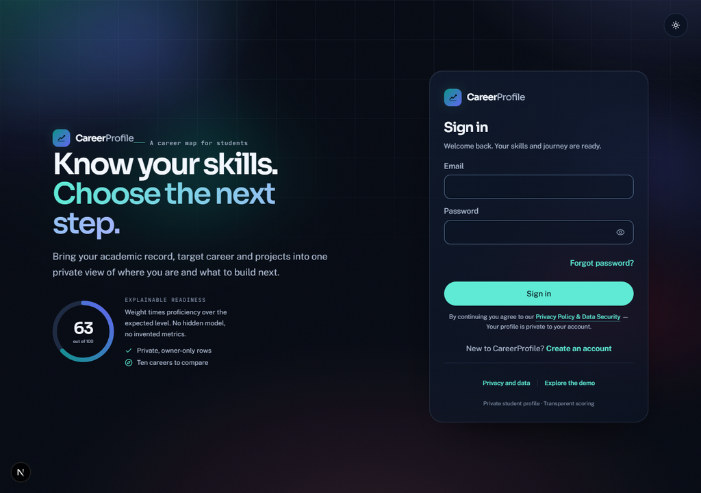
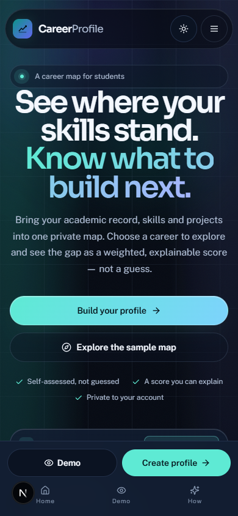
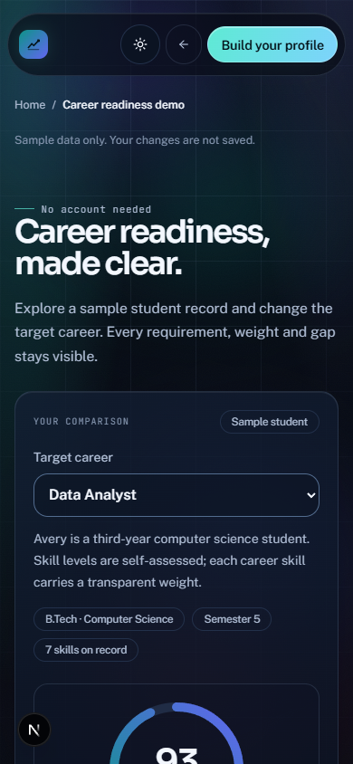

# CareerProfile

CareerProfile helps students organize their academic profile, skills, and project work, then compare self-assessed proficiency with transparent requirements for 10 target careers.

Readiness scores are weighted summaries of the student's own skill entries. They are not verified credentials or predictions of employment outcomes.

## Screenshots

| Landing page | Readiness console |
| --- | --- |
|  |  |

| Landing page, light theme | Demo page |
| --- | --- |
|  |  |

| Sign in | Landing on mobile | Demo on mobile |
| --- | --- | --- |
|  |  |  |

## Features

- Private student profile with academic details and target career.
- Skill list with proficiency levels and role-by-role comparisons.
- Project records grouped by academic year and semester.
- Rule-based next steps based on the largest weighted skill gaps.
- Sample demo at `/demo`; demo changes are not saved.

GitHub repository syncing, certificates, internships, result uploads, OCR, and admin verification are not enabled in this MVP.

## Run locally

Requirements: Node.js 20 or newer, npm, and a Supabase project.

```powershell
npm install
Copy-Item .env.example .env.local
npm run dev
```

Set `NEXT_PUBLIC_SUPABASE_URL` to the project's API URL and `NEXT_PUBLIC_SUPABASE_PUBLISHABLE_KEY` to its publishable key in `.env.local`. Restart the dev server after changing environment variables.

In the Supabase Dashboard, open **SQL Editor** and run [`supabase/bootstrap.sql`](supabase/bootstrap.sql) once to create the profile tables, signup trigger, and row-level security policies. The separate migration in `supabase/migrations` is for projects that already use this repository's legacy schema.

Open `http://localhost:3000`. Sign up, confirm the email, then add profile details, skills, and projects.

## Useful commands

```bash
npm run dev
npm run typecheck
npm run lint
npm test
npm run build
```

## Main routes

- `/` — landing page
- `/demo` — sample career comparison
- `/signup` and `/login` — account access
- `/dashboard` — readiness overview
- `/dashboard/skills` — skill tracking and career comparison
- `/dashboard/proof` — project records
- `/dashboard/journey` — semester timeline
- `/dashboard/roadmap` — skill-gap actions
- `/dashboard/profile` — academic profile

## Data and security

Authenticated access uses Supabase Auth. Row-level security scopes profile, skill, and project data to the signed-in student. Keep the Supabase service-role key server-side; the student profile flow uses the publishable key and user session.
